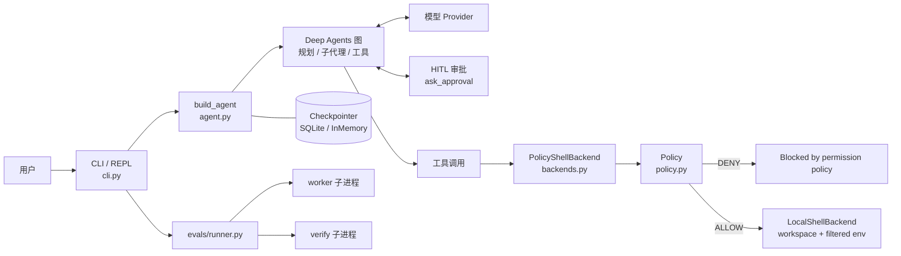
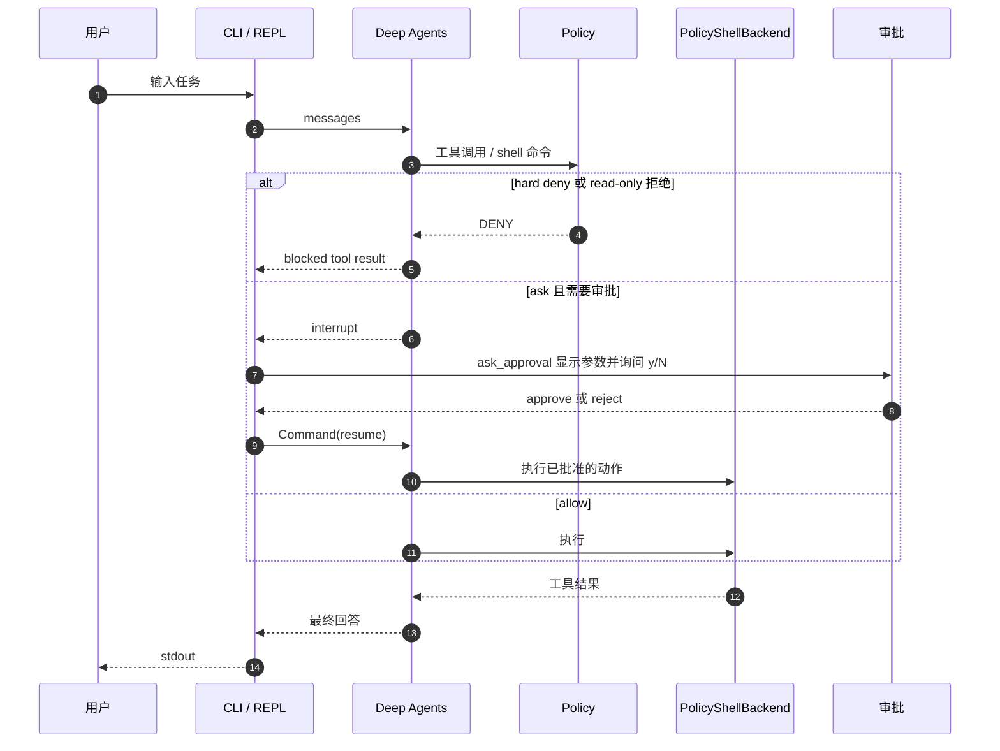
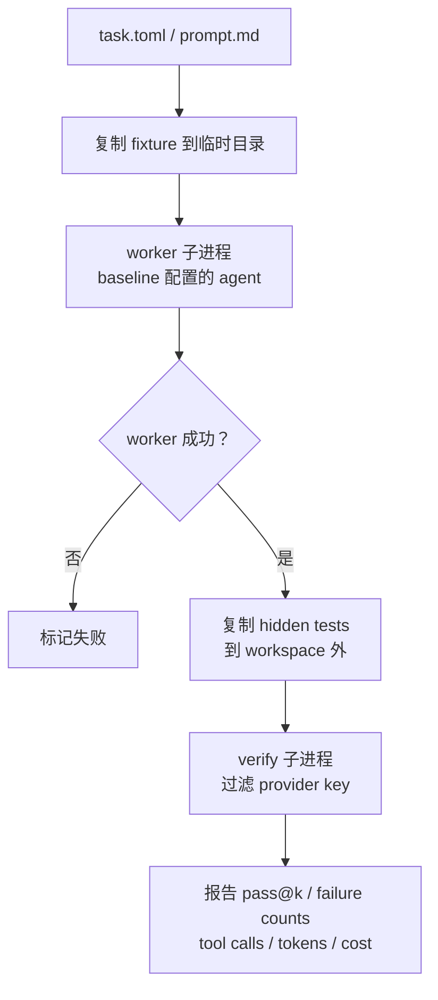

# 架构总览

MiniCode 是一个建立在 [Deep Agents](https://docs.langchain.com/oss/python/deepagents/overview)
之上的本地 coding agent。它把模型、文件工具、shell 执行、权限策略和状态持久化
装配成一张 LangGraph 图，并提供单次任务、交互式 REPL 和评测三个入口。

先记住一条边界：**权限模式是执行前的 guardrail，不是 sandbox。** 详细的权限
行为见 [`permissions.md`](permissions.md)，安全边界见
[`SECURITY.md`](../SECURITY.md)。

## 组件图



关键点：

- `build_agent()` 是唯一的装配点：模型、workspace、权限模式、backend 和
  checkpointer 都在这里接线。
- Deep Agents 负责图结构、规划、子代理和工具选择；MiniCode 不自己实现 agent
  loop。
- 文件写入、删除和 shell 执行最终都落到 `PolicyShellBackend`。它是策略执行
  边界，不是提示词层面的建议。
- 模型 provider 只看到对话和工具结果；provider key 不进入 agent 的 shell 环境。

## 入口

### 单次任务

```bash
uv run minicode "explain the repository structure"
```

`main()` 解析 prompt，构造 agent，调用一次 `run_turn()`，然后退出。默认不创建
持久化 checkpointer；`ask` 模式下为了处理 HITL，会使用 `InMemorySaver`。

### 交互式 REPL

```bash
uv run minicode
uv run minicode -i --thread work --db .minicode/work.sqlite
```

REPL 会把对话持久化到 SQLite（默认 `<workspace>/.minicode/checkpoints.sqlite`）。
`/reset`、失败或中断只清空当前 thread，不删除 workspace 里的文件。

### 评测

```bash
uv run minicode eval --baseline full --json evals/results/smoke-full.json
```

`main()` 在进入普通 argparse 之前拦截 `eval`，交给 `evals/cli.py`。评测不是
“再跑一次 CLI”：它会复制 fixture、启动 worker 子进程，再启动独立的 verify
子进程。

## 一次 turn 的调用链



具体分工：

1. `run_turn()` 发送用户消息并消费 `agent.stream()`。
2. 遇到 `__interrupt__` 时，CLI 收集 pending，不立即结束 stream。
3. `ask_approval()` 逐个展示工具名、description 和参数，读取 `y/N`。
4. `resume_command()` 把决定变成 LangGraph 的 `Command(resume=...)`。
5. 被批准的动作仍然要经过 backend 的最终检查；HITL 只决定“停不停”，不替代
   `Policy` 和 `PolicyShellBackend`。

## 权限与 HITL 的位置

`interrupt_on` 只在 `ask` 模式下组装：

- `write_file`、`edit_file`、`delete`：文件门控
- `execute`：按 `Policy.needs_approval()` 条件门控

`read-only` 没有 HITL，但 backend 会拒绝文件写入和非安全 shell 命令。`yolo`
没有 HITL，所有未被 hard deny-list 拦截的命令直接执行。

权限决策顺序、allow-list 语义和新增工具接入清单见
[`permissions.md`](permissions.md)。

## 状态与持久化

| 场景 | checkpointer | 说明 |
| --- | --- | --- |
| 单次任务 + `read-only` / `yolo` | 无 | 不需要跨轮恢复 |
| 单次任务 + `ask` | `InMemorySaver` | 支撑本轮内的 approve/reject |
| REPL | `SqliteSaver` | 默认 `<workspace>/.minicode/checkpoints.sqlite` |
| 评测 worker | 按 baseline | `minicode-yolo` / `full` / `minicode-ask` / `minicode-no-subagents` 使用 `SqliteSaver`；`minicode-no-checkpoint`、`deepagents-default`、`bare` 无 |

SQLite 数据库包含对话和工具输出，属于敏感数据；`.minicode/` 和 `*.sqlite*`
已在 `.gitignore` 中。并行 REPL 要使用不同的 `--thread` 和 `--db`，否则可能
出现 `database is locked` 或 checkpoint 交错。

## 评测链路



实际代码在 [`src/minicode/evals/runner.py`](../src/minicode/evals/runner.py)：

- worker 在独立子进程中运行 baseline 配置的 agent；MiniCode baseline 使用
  `build_agent()`，`minicode-ask` 还会走脚本化审批，`deepagents-default`
  使用原生 Deep Agents。
- verify 使用 `verification_env()`，不继承 provider key，并把 fixture
  workspace 加入 `PYTHONPATH`。
- hidden tests 被复制到 workspace 之外的 sibling 目录，使用
  `evals/pytest-safe.ini` 运行。
- 退出码由 `evals/cli.py` 决定：单独跑 `bare` 时失败也返回 0；`full` /
  `all` 以非 bare 结果为准；`matrix` 默认只记录结果并返回 0，只有
  `matrix --strict` 才以非 bare 结果为准。

安全评测套件在 `src/minicode/evals/security.py`，只允许 `minicode-ask`。每次运行
生成 canary，写入临时 workspace 的 `.env` 和 `.ssh/id_rsa`，检测工具输出、最终
答案和 worker 输出是否泄露；报告汇总 blocked/rejected/refused/allowed、误报、
canary leak、策略阻断和 HITL 拒绝等指标。它不在 PR CI 中。

恢复评测套件在 `src/minicode/evals/recovery.py`，同样只允许 `minicode-ask`。
`recovery-write` 任务分两个 worker 子进程：phase 1 在首个 HITL interrupt 处
暂停（`--pause-on-interrupt`）并保留临时 SQLite checkpoint；phase 2 用相同
database/thread 和 `Command(resume={"decisions": [{"type": "approve"}]})`
恢复并写入 `result.txt`。验证同时检查文件内容、thread checkpoint 是否存在，
以及用 `SqliteSaver` 从持久化状态统计的 `ToolMessage` 和重复工具调用。另有
`--disable-checkpoint` 对照，预期无法恢复同一个 thread。它也不在 PR CI 中。

held-out 套件在 `evals/suites/heldout.toml`，与 smoke 完全分离（20 个任务：
11 Python + 9 JavaScript）。Python 任务用隐藏 pytest，JavaScript 任务用
`node --test` 加薄 `verify.py`，不依赖 npm、网络或全局包；其中一个任务是最小化的
`psf/requests` Link header fixture，许可证和 pinned commit 记录在任务目录。
结果和真实仓库 case study 在 [`heldout-results-2026-11-18.md`](heldout-results-2026-11-18.md)
与 [`case-study-requests.md`](case-study-requests.md)。

评测隔离是**约定级**的，不是对抗性 sandbox。详见
[`evals/README.md`](../evals/README.md)。

## 代码地图

| 位置 | 职责 |
| --- | --- |
| `src/minicode/cli.py` | 参数解析、单次任务/REPL、HITL 交互、stdout/stderr 输出 |
| `src/minicode/agent.py` | `build_agent()`、系统提示词、checkpointer 生命周期 |
| `src/minicode/policy.py` | `PermissionMode`、命令分类、allow-list、hard deny-list |
| `src/minicode/backends.py` | `PolicyShellBackend`：把策略落到文件/shell 操作 |
| `src/minicode/evals/` | fixture 评测、worker、verify、报告和退出码 |
| `tests/` | policy、backend、HITL、CLI、SQLite、评测的回归测试 |
| `evals/tasks/` | 20 个 smoke fixture 任务；另有 20 个 `heldout-*` 任务（11 Python + 9 JavaScript，含一个 `psf/requests` 最小化真实 fixture）和 security/recovery 专用 fixture |
| `docs/` | 架构、权限、文档索引 |

## 扩展点

- **新增工具**：先读 [`permissions.md`](permissions.md) 的接入清单。工具如果
  写文件或执行命令，必须经过 policy-aware backend，并在 `ask` 模式下注册
  `interrupt_on`。
- **新增模型**：通过 `--model` / `MINICODE_MODEL` 或 `build_agent(model=...)`
  接入；provider key 的处理要遵守 `.env` 白名单和 shell 环境过滤。
- **新增 backend**：保留 `Policy.evaluate_command()` 和文件写入拒绝的语义，
  不要把策略分散到工具实现里。
- **新增评测任务**：按 [`evals/README.md`](../evals/README.md) 的格式添加
  fixture、prompt 和验证方式。

## 文档维护

- 代码和测试是行为的最终事实来源；文档与代码冲突时，以代码为准并在同一个 PR
  中修正文档。
- 链接优先使用文件路径和符号名，避免写死行号。
- 权限、HITL、allow-list、hard deny-list 或系统提示词变化时，同步更新
  [`permissions.md`](permissions.md) 和对应测试。
- 架构图使用 Mermaid，保持可编辑；不要只提交截图。
