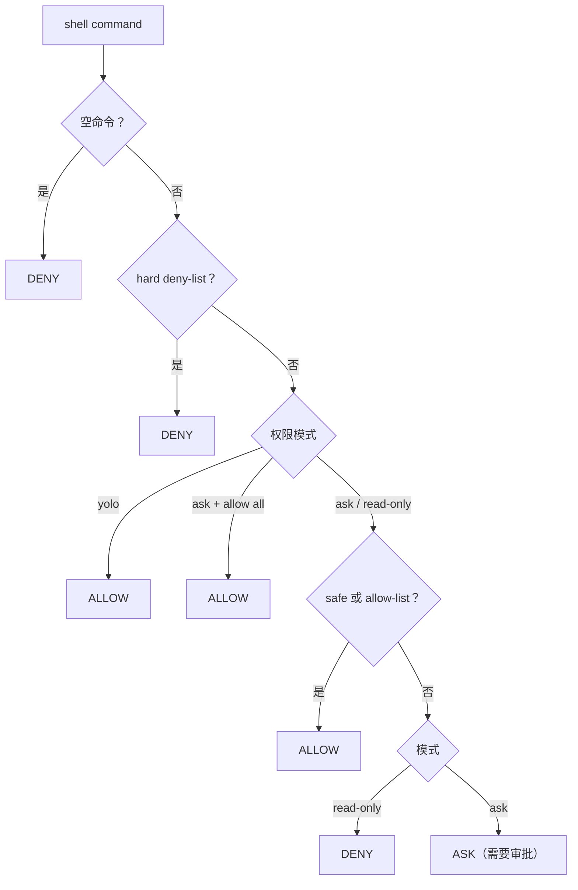

# 权限与新增工具

MiniCode 默认使用 `ask` 模式。权限策略在工具执行前生效，目标是减少误操作和
灾难性命令，不是把 agent 关进 sandbox。

相关代码：

- [`policy.py`](../src/minicode/policy.py)：模式解析、命令分类、allow-list、
  hard deny-list
- [`backends.py`](../src/minicode/backends.py)：把策略落实到文件操作和 shell
- [`agent.py`](../src/minicode/agent.py)：`build_agent()` 组装 `Policy` 和
  `interrupt_on`
- [`cli.py`](../src/minicode/cli.py)：审批交互、非 TTY 拒绝、resume

## 快速使用

```bash
uv run minicode --permission-mode read-only "review this change"
uv run minicode --permission-mode ask "fix the failing test"
uv run minicode --permission-mode yolo "run the full test suite"

uv run minicode --shell-allow-list "git status,uv run pytest" "check the tests"
uv run minicode --shell-allow-list recommended "inspect the repository"
uv run minicode --shell-allow-list all "run the migration"
```

`MINICODE_PERMISSION_MODE` 和 `MINICODE_SHELL_ALLOW_LIST` 可以设置默认值。
`.env` 加载器只应用模型和 provider key，不会加载这两个权限变量。

## 三种模式

| 行为 | `read-only` | `ask`（默认） | `yolo` |
| --- | --- | --- | --- |
| `write_file` / `edit_file` / `delete` | 拒绝 | 需要审批 | 允许 |
| 安全只读命令 | 允许 | 允许 | 允许 |
| 自定义 allow-list 命令 | 语法检查通过时允许；否则拒绝 | 语法检查通过时允许；否则需要审批 | 允许 |
| `--shell-allow-list all` | 不放开（仍按非 safe 命令拒绝） | 允许（hard deny-list 除外） | 允许（hard deny-list 除外） |
| 网络或变更类命令 | 拒绝 | 需要审批 | 允许 |
| hard deny-list | 拒绝 | 拒绝 | 拒绝 |
| 非 TTY 下需要审批的动作 | 拒绝 | 自动拒绝 | 不适用 |

补充：

- `ask` / `read-only` 的自定义 allow-list 仍要经过 `_is_safe()`。带重定向、复合
  命令、`$()`、反引号或危险参数时，allow-list 放行会失效，落到 `ASK` 或 `DENY`。
- `ask` 下的 `--shell-allow-list all` 会让所有未被 hard deny-list 拦截的命令直接
  `ALLOW`，包括网络/变更类命令和带重定向的命令；它不经过 `_is_safe()`。
- `ask` 下文件写入/删除**总是**需要审批，allow-list 不改变文件门控。
- `read-only` 下 `--shell-allow-list all` 不会放开全部命令；`all` 只对
  `ask` / `yolo` 生效。
- `read-only` 下自定义 allow-list 仍可放行特定命令，但命令要能通过
  `_is_safe()` 的语法和危险参数检查。
- `yolo` 仍然先检查 hard deny-list，灾难性命令不会被放行。

## 命令决策顺序

顺序是策略的契约，不要随意调整：



实际顺序见 [`Policy.evaluate_command()`](../src/minicode/policy.py)：

1. 空命令 → `DENY`
2. hard deny-list → `DENY`
3. `yolo` → `ALLOW`
4. `--shell-allow-list all` 且不是 `read-only` → `ALLOW`
5. safe 或 allow-list → `ALLOW`
6. 分类为 network / mutating；分类只用于决定拒绝/审批的 reason
7. `read-only` → `DENY`
8. 其余 `ask` 命令 → `ASK`

`needs_approval()` 复用同一个判定：只有 `ask` 模式下结果为 `ASK` 时才触发
审批。

## hard deny-list

以下类别在所有模式下都直接拒绝，常见例子包括：

- 管道到 `sh` / `bash` / `pwsh` / `iex` 等解释器
- fork bomb
- `shutdown`、`reboot`、`fdisk`、`diskpart`
- `mkfs*`、格式化磁盘、`dd of=/dev/...`
- 对根目录、家目录或通配符目标的递归删除
- `git push --force` / `-f`
- `chmod -R 777 /`
- `Invoke-Expression` 和 PowerShell encoded command

策略会在判断前剥离 `sudo`、`nohup`、`env`、`exec`、`command`、`time` 等前缀，
并递归检查 `sh -c` / `cmd /c` 里的命令。

这仍然是**尽力而为**的列表，不是完整 shell 解析器。不要把它当成安全边界。

## safe 前缀与 allow-list

`SAFE_COMMAND_PREFIXES` 是内置只读命令集合，例如：

- 目录/文件查看：`ls`、`dir`、`pwd`、`cat`、`type`、`head`、`tail`、`grep`、`rg`
- 查询：`where`、`which`、`whoami`
- 只读 git：`git status`、`git diff`、`git log`、`git show`、`git rev-parse`
- 版本查询：`uv --version`、`python --version`

一个复合命令只有**每个 segment** 都在 allow-list 中才算 safe；重定向、未加引号
的 `$()`、反引号、`&` 等 shell 元字符会让 safe 判定失败。`rm`、`python`、
`node`、`git commit`、`git push` 等命令不在 safe 集合里，默认需要审批。

`--shell-allow-list` 的三种形式：

- `recommended`：只使用内置 safe 前缀
- `all`：允许所有未被 hard deny-list 拦截的命令（`read-only` 除外）
- 逗号分隔的字符串：在 safe 前缀之外追加自定义前缀，例如
  `"git status,uv run pytest"`

自定义 allow-list 是前缀匹配，不是完整命令白名单。不要把 `python`、`bash`、
`sh` 之类可以执行任意代码的解释器加入 allow-list，除非你明确接受这个风险。

## HITL 审批

`ask` 模式下，[`build_agent()`](../src/minicode/agent.py) 组装
`interrupt_on`：

- `write_file`、`edit_file`、`delete`：文件门控
- `execute`：用 `Policy.needs_approval(command)` 作为 `when` 条件

审批流程：

1. `run_turn()` 消费 `agent.stream()`，把 `__interrupt__` 收集到 pending。
2. `ask_approval()` 展示工具名、description 和参数预览。
3. 交互式 TTY 读取 `y/N`；非 TTY 直接 reject，不阻塞。
4. approve 后把 `Command(resume={"decisions": [...]})` 送回图。
5. 多个 interrupt 用 interrupt id 分别构造 decisions。
6. 被 reject 的动作不会执行，提示信息明确要求不要重试。

HITL 只决定“要不要停下来问人”，不替代最终执行检查。即使已经 approve，
`PolicyShellBackend` 仍会重新检查命令和文件写入权限。

## 执行边界

[`PolicyShellBackend`](../src/minicode/backends.py) 继承
`LocalShellBackend`，覆盖了四个入口：

| 方法 | 行为 |
| --- | --- |
| `execute()` | `Policy.evaluate_command()` 返回 `DENY` 时返回 blocked result，`exit_code=126`，否则调用父类执行 |
| `write()` | `read-only` 返回 permission error，否则写入 |
| `edit()` | `read-only` 返回 permission error，否则编辑 |
| `delete()` | `read-only` 返回 permission error，否则删除 |

这意味着：

- **提示词不是执行边界**。系统提示词会说明当前模式，但真正的拒绝发生在 backend。
- **HITL 不是执行边界**。没有注册到 `interrupt_on` 的工具不会自动审批。
- 如果新工具直接调用 `LocalShellBackend`、`subprocess`、`pathlib` 或第三方 SDK，
  它可能完全绕过 MiniCode 的 policy。

## Shell 环境过滤

shell 命令只继承 `SHELL_ENV_ALLOWLIST` 中的变量，包括常见的 OS/PATH/temp
变量以及 Python、uv 相关路径。Provider key 不会进入 agent 的 shell 环境。

但要注意：

- `.env` 加载器只应用 `MINICODE_MODEL` 和已知 provider key，不会把任意变量
  注入 shell。
- 文件工具仍然可以读取 workspace 中的 `.env` 和其他文件。不要在工作区放置
  不希望模型看到的密钥。
- SQLite checkpoint 会保存对话和工具输出，按敏感数据处理。

## 安全边界

权限策略的目标是减少误操作，不是对抗恶意代码：

- `yolo` 跳过审批，只保留 hard deny-list。
- hard deny-list 不覆盖所有危险的解释器、脚本或平台命令。
- 网络访问没有独立隔离。
- 允许执行的命令本身可能有副作用，策略只做文本分类。
- 评测的 hidden tests 是约定级隐藏，不是对抗性 sandbox。
- 不可信任务应使用容器或 VM。

完整威胁模型和报告方式见 [`SECURITY.md`](../SECURITY.md)。

## 新增工具接入清单

新增一个文件写入、删除、shell 执行或外部副作用工具时，逐项确认：

- [ ] **分类副作用**：只读、文件写、shell 执行、网络请求、外部 API、状态修改。
- [ ] **经过 policy-aware backend**：文件写/删除和 shell 执行应走
      `PolicyShellBackend`（或新的 policy-aware backend），不要直接调用
      `LocalShellBackend`、`subprocess` 或 `pathlib`。
- [ ] **注册 HITL**：需要审批的工具在 `build_agent()` 的 `interrupt_on` 中加
      key。条件审批用 `InterruptOnConfig(when=...)`，不要无条件打断所有调用。
- [ ] **保证 read-only**：在 backend 层检查 `Policy.allows_file_write()` 或
      `evaluate_command()`；不要只依赖系统提示词或 `interrupt_on`。
- [ ] **扩展策略分类**：涉及新的 shell 命令类型时，更新
      `SAFE_COMMAND_PREFIXES`、`NETWORK_COMMANDS` / `NETWORK_PREFIXES`、
      `MUTATING_COMMANDS` / `MUTATING_PREFIXES` 或 hard deny-list，并补 policy
      测试。多 token 命令（例如 `git push`、`uv sync`）由前缀元组匹配，
      只改单 token 集合会漏判。
- [ ] **更新系统提示词**：权限或工作方式变化时，同步 `mode_hint()`，保证
      `read-only` / `ask` / `yolo` 的文案与实际行为一致。
- [ ] **补测试**：
      [`tests/test_policy.py`](../tests/test_policy.py)、
      [`tests/test_backends.py`](../tests/test_backends.py)、
      [`tests/test_hitl.py`](../tests/test_hitl.py)、
      [`tests/test_agent.py`](../tests/test_agent.py)、
      [`tests/test_cli.py`](../tests/test_cli.py)。
- [ ] **检查 CLI 展示**：审批界面要能看到足够的信息，不能只显示工具名。
- [ ] **检查秘密泄露**：工具参数和输出是否可能包含 provider key、`.env` 内容
      或其他敏感数据。
- [ ] **更新文档**：同步本文件和 `AGENTS.md`；如果新增权限模式，也要更新
      `mode_hint()` 的未知模式兜底。
- [ ] **验证非 TTY 行为**：无 TTY 时，需要审批的动作应 fail closed，而不是
      阻塞或静默放行。

### 一个最小检查示例

如果新工具接受任意命令字符串：

```python
decision = self._policy.evaluate_command(command)
if decision.action == DecisionAction.DENY:
    return ExecuteResponse(
        output=f"Blocked by permission policy: {decision.reason}",
        exit_code=126,
        truncated=False,
    )
```

如果新工具写文件：

```python
if not self._policy.allows_file_write():
    return WriteResult(error="Blocked by permission policy: writes are disabled")
```

真正的执行入口必须做这些检查；只在工具描述或系统提示词里写“不要写文件”不够。

## 测试矩阵

| 测试文件 | 覆盖内容 |
| --- | --- |
| `tests/test_policy.py` | 三种模式、allow-list、hard deny、复合命令、引号和危险参数 |
| `tests/test_backends.py` | `execute` 拒绝、read-only 文件拒绝、allow-list 放行 |
| `tests/test_hitl.py` | 文件/命令 interrupt、approve/reject、真实 stream resume |
| `tests/test_agent.py` | `build_agent()` 的 `interrupt_on`、checkpointer、提示词模式 |
| `tests/test_cli.py` | 审批交互、非 TTY 拒绝、resume 形状、输出 |

修改策略或新增工具后，至少运行：

```bash
uv run pytest -q tests/test_policy.py tests/test_backends.py tests/test_hitl.py
uv run pytest tests/test_agent.py tests/test_cli.py -q
```
